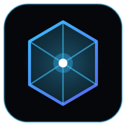

<p align="center">
  
</p>

<h1 align="center">XQuest</h1>

<p align="center">
  <strong>Zero-resource Windows process and window emulator to complete Discord Quests without downloading games.</strong>
</p>

<p align="center">
  <a href="https://github.com/XxRaay/XQuest/releases"></a>
  <a href="https://github.com/XxRaay/XQuest/actions/workflows/ci.yml"></a>
  
  
  <a href="LICENSE"></a>
</p>

<p align="center">
  <a href="#-features">Features</a> •
  <a href="#-quick-start">Quick Start</a> •
  <a href="#-how-it-works">How It Works</a> •
  <a href="#-quest-catalog">Quest Catalog</a> •
  <a href="#-development">Development</a> •
  <a href="#-license">License</a> •
  <a href="README.md">Русская версия</a>
</p>

---

## 🎯 Problem

Discord Quests (for Discord Orbs, avatar decorations, Nitro trial, and in-game drops) frequently require:
- Playing a game for **15 minutes on PC** (Honkai: Star Rail, Genshin Impact, Roblox, Fortnite, Once Human, etc.).
- Streaming a game to a friend in a voice channel for at least **15 minutes**.
- Using partner browsers (Firefox, Opera GX) for **15 minutes**.

Downloading 50–120 GB game archives or purchasing paid titles just to sit AFK for 15 minutes is inconvenient and wastes disk space. **XQuest** emulates these targets with zero setup.

---

## ✨ Features

- **Concurrent Multi-Process Emulation:** launch multiple games or browsers (e.g. Firefox and Roblox simultaneously) in isolated, concurrent sessions.
- **Zero CPU Usage (0.00% CPU):** compact C# (.NET winexe) micro-stub (~9.5 KB) consuming 0% CPU and ~4 MB RAM per process.
- **Safety Buffer (+20 seconds):** quest timer runs for 15 minutes 20 seconds (920s) to absorb Discord server ping latencies before auto-stopping.
- **Stream-Friendly Dummy Window:** generates a clean Win32 window selectable in Discord voice screen share under "Applications".
- **Arbitrary Executables & Aliases:** emulate any custom `.exe` name, browse local files via Windows Explorer, or launch comma-separated aliases (`firefox.exe, firefox-bin.exe`).
- **Discord Rich Presence (RPC):** broadcasts quest presence directly through local named pipe `\\.\pipe\discord-ipc-0`.
- **Audio & Desktop Alerts:** Web Audio API fanfare chime + native Windows OS notification when completed.

---

## 📋 Requirements

- Windows 10 or Windows 11 (64-bit)
- Node.js >= 18.0.0
- .NET Framework 4.0 / 4.8 (pre-installed on Windows)

---

## 🚀 Quick Start

### Prebuilt binaries

Download the latest version from the [Releases](https://github.com/XxRaay/XQuest/releases) page:

- **XQuest Setup x.y.z.exe** — installer (Start Menu and desktop shortcuts).
- **XQuest-Portable-x.y.z.exe** — portable build with no installation.

Releases are built automatically by GitHub Actions on every `v*` tag push (workflow: [`.github/workflows/release.yml`](.github/workflows/release.yml)).

### 1. Install from source

```powershell
cd d:\Projects\x-projects\XQuest
npm install
```

### 2. Start Application

```powershell
npm start
```

### 3. Complete a Quest

1. Open **User Settings → Quests** in Discord and accept the quest.
2. Select target game(s) or enter a custom `.exe`. Check multiple items for concurrent emulation.
3. Click **"Запустить эмуляцию"** (or **"Запустить выбранные"**).
4. Wait for **15m 20s**. A victory sound and desktop notification will appear when ready.
5. Claim your reward in Discord.

---

## ⚙️ How It Works

Discord Desktop detects games on Windows via process enumeration (`CreateToolhelp32Snapshot`). When a process executable matches Discord's registered game database, Discord updates the user's status and increments quest progress.

```
┌─────────────┐       Spawn (0% CPU)       ┌────────────────────────┐
│   XQuest    │ ─────────────────────────> │   StarRail.exe (Stub)  │
│  (Electron) │                            │    Win32 Dummy Window  │
└─────────────┘                            └────────────────────────┘
       │                                                ▲
       │ Process Check                                  │ Detection
       ▼                                                │
┌─────────────┐   CreateToolhelp32Snapshot              │
│   Discord   │ ────────────────────────────────────────┘
│   Client    │ ───> 15m 20s timer ───> Quest Completed in Discord
└─────────────┘
```

1. XQuest compiles the Win32 runner [StubRunner.cs](electron/stub/StubRunner.cs) using Windows built-in `csc.exe`.
2. When starting, the stub is cloned as the target executable (e.g. `StarRail.exe`, `RobloxPlayerBeta.exe`) into `%LOCALAPPDATA%\XQuest\emulated_bin\`.
3. The process runs with a genuine Win32 window handle and 0% resource usage, verified by Discord's native detector.
4. Safe: no memory injection, no client modification, no user tokens or self-botting.

---

## 🎮 Quest Catalog

| Application / Game | Executable (.exe) | Category | Typical Reward |
| :--- | :--- | :--- | :--- |
| **Honkai: Star Rail** | `StarRail.exe` | Game | 30 Stellar Jade + Orbs |
| **Roblox** | `RobloxPlayerBeta.exe` | Game | In-game loot + 100 Orbs |
| **Mozilla Firefox** | `firefox.exe, firefox-bin.exe` | Browser | Partner Profile Decor |
| **Genshin Impact** | `GenshinImpact.exe` | Game | 30 Primogems + Avatar Frame |
| **Zenless Zone Zero** | `ZenlessZoneZero.exe` | Game | 60 Polychromes + Orbs |
| **Fortnite** | `FortniteClient-Win64-Shipping.exe` | Game | Exclusive Wrap / Decor |
| **Opera GX** | `opera.exe` | Browser | Discord Nitro / Decor |
| **Marvel Rivals** | `MarvelRivals.exe` | Game | Title + Spray |
| **Once Human** | `ONCE_HUMAN.exe` | Game | Butterfly Crate + Orbs |
| **Warframe** | `Warframe.x64.exe` | Game | 3-day Resource Booster |
| **Google Chrome** | `chrome.exe` | Browser | Partner Orbs rewards |
| **World of Tanks** | `WorldOfTanks.exe` | Game | 1-day Premium Account |
| **Dead by Daylight** | `DeadByDaylight-Win64-Shipping.exe` | Game | Charm + Bloodpoints |
| **Custom Process** | Any `.exe` name | Custom | Any Discord quest |

---

## 💻 Development

```powershell
# Run with live Hot-Reload
npm run dev

# Full production build
npm run build

# Compile C# stub only
npm run build:stub

# Compile TypeScript Electron backend only
npm run build:electron

# Build Vite UI only
npm run build:ui

# Package executable .exe (Installer + Portable)
npm run dist

# Package Portable .exe only
npm run dist:portable
```

### Publishing a release

GitHub Actions builds the installer and the portable build and creates a GitHub Release automatically — just push a tag:

```powershell
npm version patch   # or minor / major: bumps package.json and creates a tagged commit
git push --follow-tags
```

Manual run: **Actions → Release → Run workflow** (version can be specified).

---

## 📄 License

Distributed under the [Fair Community & AI License (FCAIL) 1.7](LICENSE). Copyright © 2026 XxRaay.
