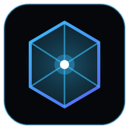

<p align="center">
  
</p>

<h1 align="center">XQuest</h1>

<p align="center">
  <strong>Легковесный эмулятор процессов и окон для выполнения квестов Discord без скачивания игр.</strong>
</p>

<p align="center">
  <a href="https://github.com/XxRaay/XQuest/releases"></a>
  <a href="https://github.com/XxRaay/XQuest/actions/workflows/ci.yml"></a>
  
  
  <a href="LICENSE"></a>
</p>

<p align="center">
  <a href="#-возможности">Возможности</a> •
  <a href="#-быстрый-старт">Быстрый старт</a> •
  <a href="#-как-это-работает">Как это работает</a> •
  <a href="#-каталог-квестов">Каталог квестов</a> •
  <a href="#-разработка">Разработка</a> •
  <a href="#-лицензия">Лицензия</a> •
  <a href="README.en.md">English</a>
</p>

---

## 🎯 Проблема

Квесты Discord (на получение Орбсов, декораций аватара, Discord Nitro и внутриигровых предметов) требуют:
- Играть в игру **15 минут на ПК** (Honkai: Star Rail, Genshin Impact, Roblox, Fortnite, Once Human и др.).
- Стримить игру другу в голосовом канале не менее **15 минут**.
- Использовать партнерские браузеры (Firefox, Opera GX) в течение **15 минут**.

Скачивать 50–120 ГБ тяжелых файлов или покупать платные игры ради 15 минут AFK не имеет смысла. **XQuest** решает эту задачу без установки самих игр.

---

## ✨ Возможности

- **Параллельная эмуляция нескольких квестов:** одновременный запуск сразу нескольких игр и браузеров (например, Firefox и Roblox) в изолированных независимых сессиях.
- **Нулевая нагрузка на процессор (0.00% CPU):** микро-стаб на C# (.NET winexe) размером ~9.5 КБ потребляет 0% CPU и ~4 МБ оперативной памяти на процесс.
- **Буфер безопасности (+20 секунд):** таймер длится 15 минут 20 секунд (920с). Это компенсирует задержку сетевых пингов серверов Discord и гарантирует 100% зачёт квеста перед закрытием.
- **Окно для квестов на стрим:** создание темного Win32-окна с именем игры, которое Discord распознает во вкладке «Приложения» при демонстрации экрана.
- **Любые процессы и алиасы:** эмуляция любого пользовательского `.exe`, выбор файла через проводник Windows и запуск вариантов через запятую (`firefox.exe, firefox-bin.exe`).
- **Штатный Discord RPC:** передача статуса квеста через локальный именованный сокет `\\.\pipe\discord-ipc-0`.
- **Звук и уведомления:** победный звуковой аккорд (Web Audio API) и нативное системное уведомление Windows по завершении.

---

## 📋 Требования

- Windows 10 или Windows 11 (64-bit)
- Node.js >= 18.0.0
- .NET Framework 4.0 / 4.8 (встроен в Windows по умолчанию)

---

## 🚀 Быстрый старт

### Готовые сборки

Скачайте последнюю версию со страницы [Releases](https://github.com/XxRaay/XQuest/releases):

- **XQuest Setup x.y.z.exe** — установщик (ярлыки в «Пуск» и на рабочем столе).
- **XQuest-Portable-x.y.z.exe** — портативная версия без установки.

Сборка релизов выполняется автоматически в GitHub Actions при пуше тега `v*` (workflow: [`.github/workflows/release.yml`](.github/workflows/release.yml)).

### 1. Установка из исходников

```powershell
cd d:\Projects\x-projects\XQuest
npm install
```

### 2. Запуск приложения

```powershell
npm start
```

### 3. Выполнение квеста

1. Откройте **Настройки пользователя → Квесты** в Discord и примите задание.
2. В XQuest выберите игру из каталога или введите своё имя `.exe`. При необходимости отметьте несколько квестов галочками для одновременного запуска.
3. Нажмите **«Запустить эмуляцию»** (или **«Запустить выбранные»**).
4. Оставьте окно на **15м 20с**. По окончании прозвучит победный сигнал и появится уведомление.
5. Заберите награду в Discord.

---

## ⚙️ Как это работает

Discord Desktop отслеживает игры на Windows через периодическое сканирование запущенных процессов (`CreateToolhelp32Snapshot`). Когда исполняемый файл процесса совпадает с базой игр Discord, клиенту присваивается статус игры, а внутренний таймер квеста начинает отсчёт.

```
┌─────────────┐       Spawn (0% CPU)       ┌────────────────────────┐
│   XQuest    │ ─────────────────────────> │   StarRail.exe (Стаб)  │
│  (Electron) │                            │    Win32 Dummy Window  │
└─────────────┘                            └────────────────────────┘
       │                                                ▲
       │ Проверка процессов                             │ Детекция
       ▼                                                │
┌─────────────┐   CreateToolhelp32Snapshot              │
│   Discord   │ ────────────────────────────────────────┘
│   Client    │ ───> 15м 20с таймер ───> Зачёт квеста в Discord
└─────────────┘
```

1. XQuest компилирует универсальный Win32-раннер [StubRunner.cs](electron/stub/StubRunner.cs) через системный компилятор `csc.exe`.
2. При запуске стаб копируется в целевое имя файла (например, `StarRail.exe` или `RobloxPlayerBeta.exe`) в изолированную директорию `%LOCALAPPDATA%\XQuest\emulated_bin\`.
3. Запущенный процесс имеет настоящее окно Win32 и 0% нагрузки, благодаря чему Discord видит его как подлинную запущенную игру.
4. Безопасность: XQuest не использует инъекции памяти, не модифицирует файлы Discord и не требует пользовательских токенов.

---

## 🎮 Каталог квестов

| Программа / Игра | Имя файла (.exe) | Категория | Стандартная награда |
| :--- | :--- | :--- | :--- |
| **Honkai: Star Rail** | `StarRail.exe` | Игра | 30 Звёздного Нефрита + Orbs |
| **Roblox** | `RobloxPlayerBeta.exe` | Игра | Внутриигровой лут + 100 Orbs |
| **Mozilla Firefox** | `firefox.exe, firefox-bin.exe` | Браузер | Партнерский декор профиля |
| **Genshin Impact** | `GenshinImpact.exe` | Игра | 30 Камней Истока + Рамка аватара |
| **Zenless Zone Zero** | `ZenlessZoneZero.exe` | Игра | 60 Полихромов + Orbs |
| **Fortnite** | `FortniteClient-Win64-Shipping.exe` | Игра | Эксклюзивная обертка / Декор |
| **Opera GX** | `opera.exe` | Браузер | Месяц Discord Nitro / Декор |
| **Marvel Rivals** | `MarvelRivals.exe` | Игра | Титул + Спрей |
| **Once Human** | `ONCE_HUMAN.exe` | Игра | Ящик бабочки + Очки Orbs |
| **Warframe** | `Warframe.x64.exe` | Игра | 3-дневный бустер ресурсов |
| **Google Chrome** | `chrome.exe` | Браузер | Партнерские награды Orbs |
| **World of Tanks** | `WorldOfTanks.exe` | Игра | 1 день премиум-аккаунта |
| **Dead by Daylight** | `DeadByDaylight-Win64-Shipping.exe` | Игра | Амулет + Кровавые очки |
| **Любой процесс** | Любое имя `.exe` | Свой | Любые кастомные квесты |

---

## 💻 Разработка

```powershell
# Запуск в режиме разработки с Hot-Reload
npm run dev

# Полная сборка проекта
npm run build

# Компиляция только C# стаба
npm run build:stub

# Сборка только TypeScript бэкенда Electron
npm run build:electron

# Сборка интерфейса Vite
npm run build:ui

# Сборка готовых .exe (Installer + Portable)
npm run dist

# Сборка только Portable .exe
npm run dist:portable
```

### Публикация релиза

GitHub Actions сам соберёт установщик и портативную версию и создаст GitHub Release — достаточно запушить тег:

```powershell
npm version patch   # или minor / major: обновит package.json и создаст коммит с тегом
git push --follow-tags
```

Ручной запуск: **Actions → Release → Run workflow** (можно указать версию).

---

## 📄 Лицензия

Распространяется под лицензией [Fair Community & AI License (FCAIL) 1.7](LICENSE). Copyright © 2026 XxRaay.
